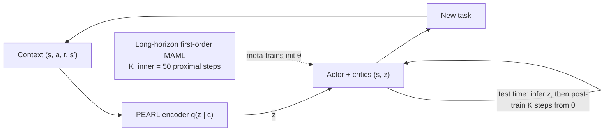
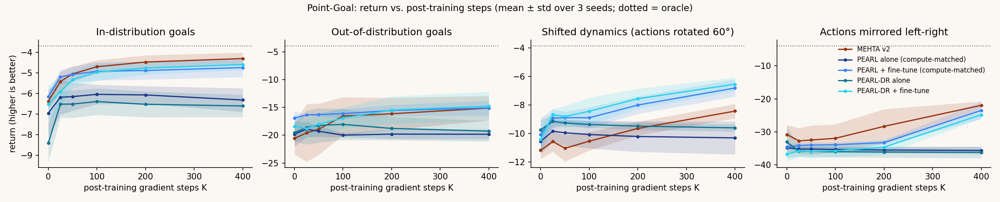
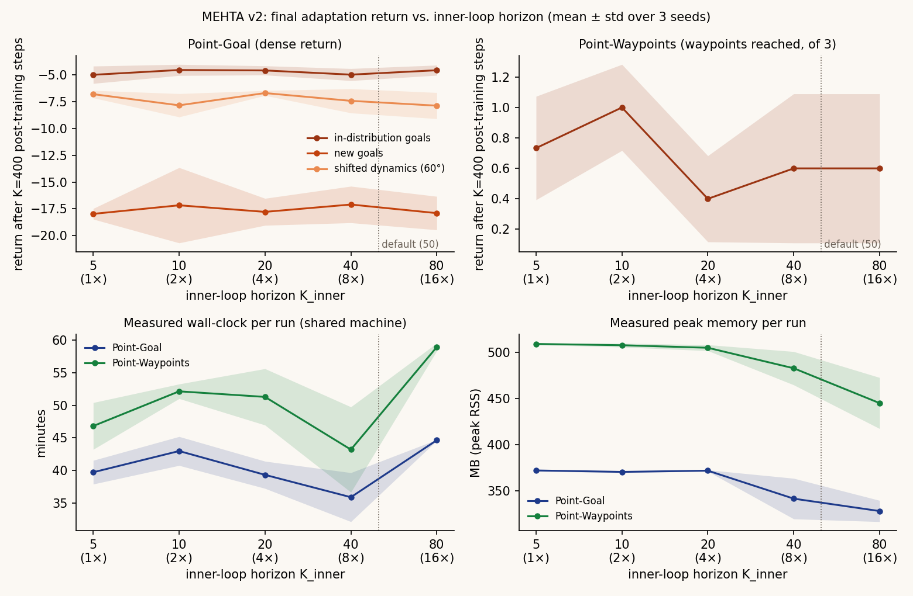

# MEHTA Learning

**PEARL's latent task inference combined with long-horizon MAML for meta-RL post-training: the method, small-scale experiments, and an in-browser demo.**

<p align="center"></p>




| | |
|---|---|
|  |  |

**Website:** https://amalmehta.github.io/MEHTAlearning/ · **Status:** small-scale pilot (2-D tasks, 3 seeds, CPU)

**Pilot result:** latent inference plus post-training clearly beats either alone. The meta-learned initialization (MAML step) showed **no measurable gain** over plain fine-tuning, both in v1 and in a diagnosed v2 redesign confirmed on fresh seeds. v2's potential-based shaping took long sparse episodes from 0% to 27–60% success for every method. v3 tested a pre-registered hard shift (mirrored actions): MEHTA v2 started better but adapted no faster, and did not beat compute-matched PEARL + fine-tune.

| v3 (fresh seeds 6–8, mirrored actions) |
|---|
|  |

**Horizon ablation** (fresh seeds 12–14): MEHTA v2's inner-loop horizon swept over 5, 10, 20, 40 and 80 steps (1×–16× the short setting), with nothing else changed. Final return after 400 post-training steps is **flat** on every task set. On Point-Goal in-distribution goals, 16× scores −4.57 ± 0.47 against −4.99 ± 0.81 at 1×, and Waypoints is noisy with no trend. Going to 16× costs 1.5× the meta-training sample-gradients and buys nothing measurable. Wall-clock and memory were measured on a heavily shared machine, so they are noisy. Reproduce with `uv run python -m mehta.horizon_sweep`.



| v2 (fresh seeds 3–5) | |
|---|---|
|  |  |

## Meta-World ML1 (level 1.5)

A third environment family sits between the 2-D tasks and the level-2 plan: Meta-World ML1 `reach-v3`, `push-v3` and `pick-place-v3` (`mw_reach`, `mw_push`, `mw_pick_place`). It uses the same `Env(task)` / `make_task_sets` interface as `point_goal` and `waypoints`, so PEARL, MEHTA and MAML run on it with no changes to the algorithms.

- **Tasks:** ML1's goal positions (fixed with benchmark seed 0). There are 40 train goals and 5 validation goals. Each seed draws 5 of ML1's 50 held-out test goals. The goal is hidden from the observation, so it has to be inferred from reward.
- **Episodes:** 200 steps with γ = 0.99, 10× the point tasks. Push and pick-place are reach → contact or grasp → move, so the final reward depends on actions taken many steps earlier.
- **Reward:** Meta-World's dense v3 reward, scaled to [0, 1] per step, for both the critic and the context. Success is tracked on the env but not logged yet.
- **CPU budget:** 100 training iterations (about 350k env steps), with post-training checkpoints at K ∈ {0, 50, 100, 200}.

Install and run:

```bash
uv sync --group metaworld
uv run --group metaworld python -m mehta.experiments --env mw_push --method mehta --seed 0
```

A plain `uv sync` removes the optional group again. Running `uv run --group metaworld pytest` includes the Meta-World tests.

**Seed-0 pipeline check on `mw_push`** (`results/mw_push/*_s0.json`): this shows that every method trains, adapts and evaluates end to end. It is not a result. Mean return on the 5 held-out goals is out of a possible 200:

| Method | K = 0 | K = 200 | Wall-clock |
|---|---|---|---|
| PEARL | 1.15 | 1.15 | 52 min (both variants) |
| PEARL + fine-tune | 1.15 | 1.14 | |
| MEHTA | 1.05 | 1.05 | 52 min |
| MAML | 1.11 | 1.11 | 50 min |

At this budget no method learns to push: about 1.1 out of 200 is the reward for never touching the puck. The family needs the level-2 budget (GPU, compute-matched) before any comparison means anything.

- [Instructions](docs/INSTRUCTIONS.md): setup, reproduce everything with one command, view the site, manual review checklist
- [System design](docs/SYSTEM-DESIGN.md): architecture, flows, decisions, testing, limits
- [File structure](docs/FILE-STRUCTURE.md)
- [Level-2 plan](docs/LEVEL-2-PLAN.md): HalfCheetah-Vel and Meta-World, compute-matched, cost and where to run
- [Project spec](MEHTAlearning.md): definitions, decisions and what's deferred
