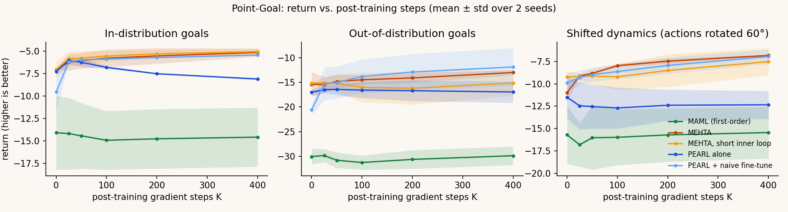
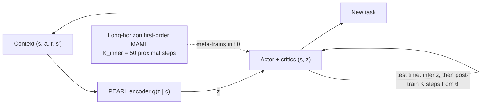
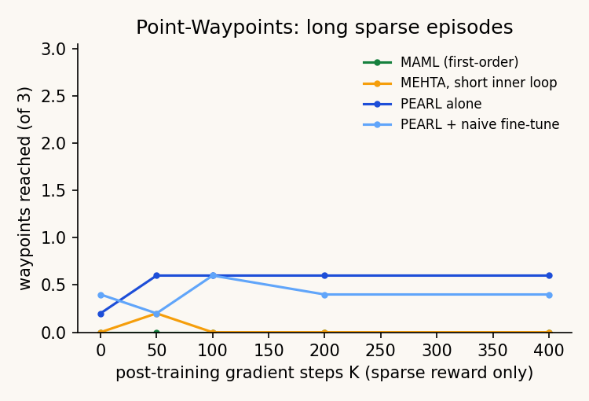
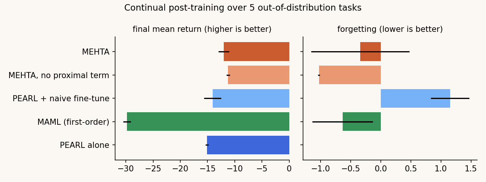
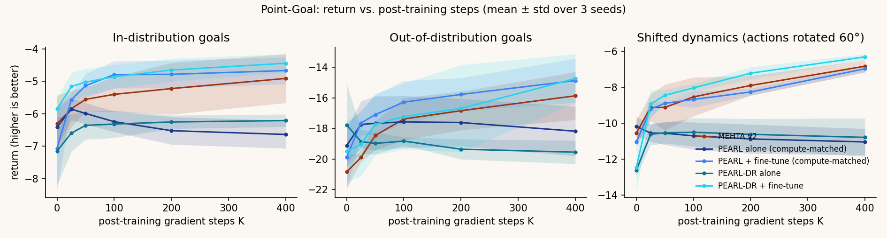
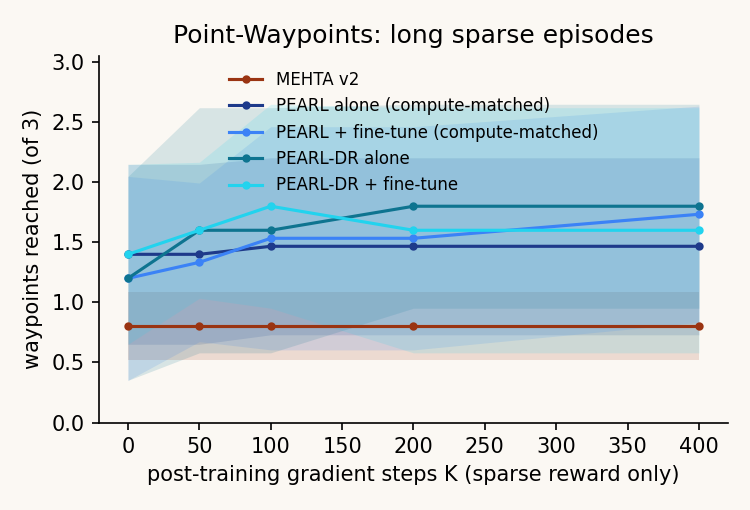

# MEHTA Learning

**PEARL's latent task inference combined with long-horizon MAML for meta-RL post-training: the method, small-scale experiments, and an in-browser demo.**

| | |
|---|---|
|  |  |

**Website:** https://amalmehta.github.io/MEHTAlearning/ · **Status:** small-scale pilot (2-D tasks, 3 seeds, CPU)

**Pilot result:** latent inference plus post-training clearly beats either alone. The meta-learned initialization (MAML step) showed **no measurable gain** over plain fine-tuning, both in v1 and in a diagnosed v2 redesign confirmed on fresh seeds. v2's potential-based shaping took long sparse episodes from 0% to 27–60% success for every method.

| v2 (fresh seeds 3–5) | |
|---|---|
|  |  |

- [Instructions](docs/INSTRUCTIONS.md): setup, reproduce everything with one command, view the site, manual review checklist
- [System design](docs/SYSTEM-DESIGN.md): architecture, flows, decisions, testing, limits
- [File structure](docs/FILE-STRUCTURE.md)
- [Level-2 plan](docs/LEVEL-2-PLAN.md): HalfCheetah-Vel and Meta-World, compute-matched, cost and where to run
- [Project spec](MEHTAlearning.md): definitions, decisions and what's deferred
