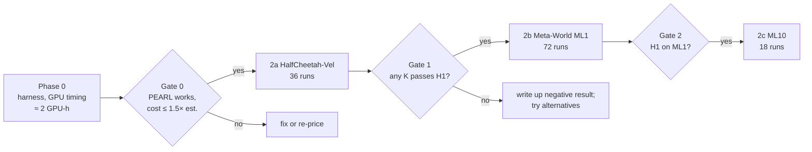

# Level-2 Experiment Plan: HalfCheetah-Vel and Meta-World

Status: **plan, not yet run.** Drafted 2026-10-20 after the level-1 pilot. Every
cost below is an estimate built from the measurements and prices cited, and the
formulas are given so it can be re-priced after Phase 0.

## Why level 2, and what would change our mind

The level-1 pilot found that latent inference plus post-training beats either
alone. The new piece, a long-horizon first-order MAML update, showed **no clear
gain** over PEARL + plain fine-tuning. Long vs short inner loops also showed no
clear difference. Level 1 could not separate "the idea doesn't work" from "the
tasks are too easy, the runs too short, and the baselines not matched."
Level 2 is built to separate them:

| Hypothesis | Test | Supported if |
|---|---|---|
| **H1** MEHTA's meta-learned init post-trains better than PEARL's | MEHTA(K\*) vs PEARL + fine-tune, **compute-matched**, on held-out tasks at K = 400 | Paired MEHTA − baseline difference: 95% bootstrap CI above 0 **and** the pilot's rule (gap > summed seed std) |
| **H2** Longer inner loops help (the "long-horizon" claim) | K_inner ∈ {5, 20, 50, 200} at a fixed budget | OOD return rises with K_inner; K\*=200 or 50 beats K=5 under H1's criterion |
| **H3** The proximal term limits forgetting | Continual sequence, MEHTA λ = 0.5 vs λ = 0 | Forgetting lower with λ, under H1's criterion |

**Stop rule (decided before any run):** if no K_inner passes H1 on any
held-out set of HalfCheetah-Vel, Meta-World is not run. The negative result is
written up instead, and we move to the alternatives in "If it fails".

## Environments

| Stage | Environment | Tasks | Held-out (OOD) sets | Episode | Metric |
|---|---|---|---|---|---|
| 2a | **HalfCheetah-Vel** (Gymnasium `HalfCheetah-v5`, MuJoCo 3) | target velocity; reward −\|v − v\*\| − 0.05‖a‖², as in PEARL's [`half_cheetah_vel.py`](https://github.com/katerakelly/oyster/blob/master/rlkit/envs/half_cheetah_vel.py) | ID: v\* ∈ [0, 2]; **OOD-velocity**: v\* ∈ [2.5, 3]; **OOD-dynamics** (sim-to-real proxy): ID velocities with torso mass ×1.5 and friction ×0.6 | 200 steps | return at K ∈ {0, 50, 100, 200, 400, 1000} |
| 2b | **Meta-World ML1** `push-v3`, `pick-place-v3` (Meta-World+ [arXiv:2505.11289](https://arxiv.org/abs/2505.11289)) | 50 train goal positions per task | the benchmark's held-out test goals | 500 steps | success rate (standard), return secondary |
| 2c | **Meta-World ML10** (only if 2b supports H1) | 10 train tasks | 5 held-out *tasks*, a real task-level shift | 500 steps | success rate |

Notes that matter for honesty:
- PEARL's velocity code samples v\* from U[0, 3], although its docstring says [0, 2]. We split that range into ID [0, 2] and OOD [2.5, 3].
- PEARL ran on mujoco-py and the old Gym; we use Gymnasium v5 and MuJoCo 3.3. Absolute returns are **not comparable** to PEARL's paper. We compare methods only within our harness.
- Meta-World v3.1.1 tripped an assertion in `make_vec("Meta-World/ML1-train")` with default settings on 2026-10-20. The single-env `MT1` path worked. Phase 0 must pin a working construction for the train and test goal splits.

## Methods: compute-matched by construction

Each run gets the same budget, **G = 300,000 update-equivalents**. One
update-equivalent is one gradient step on 16 tasks × 256 samples, or 30% of
PEARL's default 500 iterations × 2,000 steps
([config](https://github.com/katerakelly/oyster/blob/master/configs/default.py)).
MEHTA's inner loops run **batched across 16 tasks** (`torch.func.vmap` over
per-task weight copies), so one batched inner step costs about one PEARL update
in FLOPs and wall-clock. This is what makes compute matching real rather than
nominal.

| Training config | PEARL updates | Inner-loop steps | Latent |
|---|---|---|---|
| **PEARL-cm** (compute-matched) | 300k | 0 | yes |
| **MAML-FO** | 200k multi-task | 100k (K_inner = 50) | no |
| **MEHTA K5 / K20 / K50 / K200** | 200k | 100k, in 20k / 5k / 2k / 500 outer steps | yes |

That's 6 trainings per environment. Evaluation variants: PEARL alone (no
gradient steps), **PEARL + fine-tune** (from PEARL-cm weights), MAML-FO, each
MEHTA K, and MEHTA(K\*) with λ = 0 for the continual test. All variants share the
post-training protocol from level 1.

Network sizes match PEARL: 3×300 actor and critics, 3×200 encoder, latent 5.
The KL weight is re-checked on the dev seed, because PEARL's reward scale
differs per environment (5 by default, 100 for the sparse point robot).

## Seeds and statistics

- **5 confirmatory seeds (0–4)** plus **1 dev seed (100)**. The dev seed is used only for setup bugs and the KL/temperature check; nothing is tuned on held-out tasks.
- Report mean ± std per seed, plus **IQM with 95% stratified bootstrap CIs** over seeds × tasks via rliable (Agarwal et al. 2021, [arXiv:2108.13264](https://arxiv.org/abs/2108.13264)). H1 uses **paired** per-seed differences, since each seed's MEHTA and PEARL+FT share collection RNG.
- Pre-registration: this file, the configs and the stop rule are committed **before** seeds 0–4 run. Every run is reported, including negative ones.

## Compute: measured, estimated, priced

**Measured on this Mac** (Intel i9, shared and heavily loaded, so treat as upper bounds):

| Quantity | Value |
|---|---|
| HalfCheetah-v5 env steps, random actions, 1 core | 2,512 / s |
| Meta-World `reach-v3` (MT1) env steps, 1 core | 497 / s |
| One PEARL-size update (16 × 256, 3×300 nets), 1 thread | 768 ms |
| same, 4 threads | 393–520 ms |

**Sanity check (estimate):** a forward-and-backward pass through 3×300 actor and twin critics, plus targets, is about 18 network passes × ~190k multiply-adds per sample × 4,096 samples ≈ **28 GFLOP per update**. At ~40 GFLOP/s per CPU core that's ~0.7 s, which matches the measurement. So updates must run on a GPU: on the Mac, 300k updates would take ≈ 64 h per run.

**GPU assumption (estimate, to be measured in Phase 0):** 4–10 ms per update on an NVIDIA L4. That's 28 GFLOP at 10–30% of the L4's fp32 peak, plus kernel-launch overhead for small networks.

| Stage | Runs | Per-run estimate | GPU-hours |
|---|---|---|---|
| Phase 0: harness + timing | — | — | ≈ 2 |
| 2a HalfCheetah-Vel | 6 configs × (5 + 1) seeds = **36** | 300k updates (20–50 min) + 1.2M env steps (2–8 min) + eval (≈ 5 min) ≈ **0.5–1.2 h** | **18–43** |
| 2b Meta-World ML1 ×2 tasks | **72** | same updates + 2.6M env steps on 8 cores (6–11 min) + longer eval ≈ **0.6–1.5 h** | **43–108** |
| 2c Meta-World ML10 | 3 configs (PEARL-cm, MAML-FO, MEHTA K\*) × 6 = **18** | 2× budget ≈ **1.5–3 h** | **27–54** |

**Prices** (checked 2026-10-20; re-check before running):
- [Modal](https://modal.com/pricing): L4 $0.000222/s (≈ $0.80/h), CPU ≈ $0.047 per physical core-hour, memory ≈ $0.008 per GiB-hour, per-second billing, $30/month included on the free Starter plan.
- [RunPod](https://www.runpod.io/pricing): L4 $0.44/h community / $0.59/h secure, CPU and RAM included in the pod.
- AWS c7i spot (third-party snapshot via [Holori](https://calculator.holori.com/aws/ec2/c7i.xlarge/us-east-1)): ≈ $0.012–0.021 per vCPU-hour, with 15–20%+ interruption rates.

| Stage | Modal (L4 + 4–8 cores + 16–32 GiB ≈ $1.12–1.44/h) | RunPod community L4 ($0.44/h) |
|---|---|---|
| Phase 0 | ≈ $3 (inside the free $30) | ≈ $1 |
| 2a HalfCheetah-Vel | **$20–48** | $8–19 |
| 2b Meta-World ML1 | $62–156 | $19–48 |
| 2c Meta-World ML10 | $39–78 | $12–24 |
| **All stages** | **≈ $125–285** | **≈ $40–92** |

How these are computed: GPU-hours × hourly rate. Storage, egress and failed or
retried runs are not included, so add about 20% headroom. A CPU-only spot fleet
would cost roughly $2 per run, but about 33 h of wall-clock per run with
interruptions. That's cheap, but too slow to iterate on.

## Where to run it (recommendation)

1. **Phase 0 and 2a on Modal.** Per-second billing, no idle cost, 36 runs fanned out as parallel containers (about 1–2 h wall-clock for all of 2a), and it fits inside the free credits plus about $20–50. It's plain Python (`modal run`), with results written to a Modal Volume and pulled into `results/level2/`.
2. **2b and 2c on RunPod community L4 pods** if they go ahead. They're about 3× cheaper for the long Meta-World runs, but need pod management and checkpoint/resume (community pods can be preempted).
3. **This Mac:** development and unit tests only.

Who pays: you. Set a hard spend limit before Phase 1. My suggestion is **$75 for Phase 0 + 2a**, revisited at Gate 1.

## Phases and gates

- **Gate 0:** PEARL-cm on HalfCheetah-Vel must beat a no-latent multi-task SAC on ID tasks after 2 exploration episodes (the harness works), and the measured ms per update must be within 1.5× of the estimate. Otherwise fix or re-price before spending more.
- **Gate 1:** the stop rule above.
- **Gate 2:** run ML10 only if H1 holds on at least one ML1 task.

## Engineering needed before Phase 0 (in this repo)

1. Device support (`--device cuda`) and checkpoint/resume every N iterations.
2. Batched inner loop: `torch.func.stack_module_state` + `vmap` over 16 task copies, with a test that it equals the sequential loop.
3. Environment wrappers: `HalfCheetahVel` (v5, ID/OOD splits, mass/friction shift through `model.body_mass` and `geom_friction`), Meta-World ML1/ML10 task samplers with fixed splits, and the success metric.
4. Budget accounting in update-equivalents, logged per run, with a test that every config spends exactly G.
5. Vectorized collection (Gymnasium `SyncVectorEnv`), so env stepping doesn't starve the GPU.
6. A Modal app (`modal_app.py`) that maps (env, config, seed) to a container and writes JSON to a Volume.
7. rliable-based reporting and new site sections, with level-2 results kept separate from level 1.

Pinned versions: torch 2.2.2 (as level 1; CUDA 12.1 wheels exist), gymnasium 1.4.0,
mujoco 3.3.0, metaworld 3.1.1. These are the versions installed and measured above.

## If it fails

If Gate 1 fails, the most informative next tries are, in order:
1. An inner loop that **collects fresh on-policy data**, the way post-training does at test time, instead of replaying stored data.
2. **Implicit (iMAML) meta-gradients** in place of the first-order Reptile step.
3. Testing whether the latent already absorbs everything a better initialization would give, by comparing post-training with the encoder frozen vs fine-tuned.

## Open decisions for you

- Spend limit, and whether to use Modal only or Modal + RunPod.
- Whether to include `HalfCheetah-Dir`. It has only 2 tasks, so it's weak for OOD; I recommend skipping it.
- Whether level-2 results go on the same website or a separate page.
