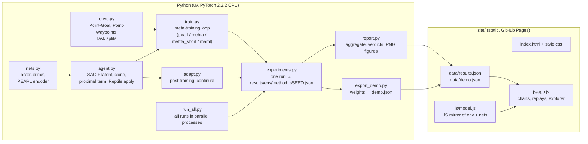

# System Design

MEHTA Learning is a small, reproducible research codebase plus a static website.
The Python side trains and evaluates meta-RL agents and writes JSON; the website
only reads that JSON. Nothing runs on a server.

## Architecture

## Components

| Component | Job |
|---|---|
| `mehta/envs.py` | Pure-NumPy environments and fixed task splits (train, ID, OOD-goal, OOD-dynamics, continual, validation). Each step returns two rewards: the one the critic meta-trains on and the one the encoder and evaluation see. |
| `mehta/nets.py` | Tanh-Gaussian actor, Q-network, PEARL product-of-Gaussians encoder, KL to N(0, I). |
| `mehta/agent.py` | SAC v2 conditioned on z. `pearl_update` (meta-batch, KL, encoder trained through the critic), `sac_update` with an optional proximal anchor, `clone_for_adaptation` (copies policy nets, shares the frozen encoder), `reptile_apply` (first-order meta-update). |
| `mehta/train.py` | One meta-training loop for every method; switches: latent on/off, K_inner (0 = no MAML step). |
| `mehta/adapt.py` | The test-time protocol shared by all variants: explore, infer z, K proximal SAC steps on the task's own data using only the test-time reward. Also the continual sequence and its metrics. |
| `mehta/experiments.py` | Train one (env, method, seed), run all its evaluation variants, write one JSON; seed 0 also saves models and trajectories. |
| `mehta/run_all.py` | Runs every (env, method, seed) as separate single-thread processes, resumable; then report and export. |
| `mehta/report.py` | Mean ± std over seeds, the "beats" verdicts, README figures, `site/data/results.json`. |
| `mehta/export_demo.py` | Seed-0 weights, post-trained snapshots, latent-space PCA and a parity fixture → `site/data/demo.json`. |
| `site/` | Distill-style article. `model.js` re-implements the env, MLP and encoder in plain JS so the demo runs client-side. |

## Main flows

1. **Meta-training** (`train.py`). Each iteration: collect episodes on 5 training tasks (prior z, then posterior z); 75 PEARL updates (300 iterations) on meta-batches of 4 tasks; every 2nd iteration (MEHTA, MAML), a first-order MAML step: 2 tasks × K_inner proximal SAC steps on cloned weights, then θ ← θ + β·mean(θᵢ − θ). The inner loop uses the test-time reward ("train as you test").
2. **Post-training** (`adapt.py`). Explore 2 episodes → z; then K steps, collecting one episode every 10 steps and re-inferring z from all context; score a deterministic episode at checkpoints. PEARL-alone collects the same episodes but takes no gradient steps.
3. **Continual**. Five OOD tasks in sequence, 100 steps each, weights carried over, anchor = meta-init; R[i][j] = return on task j after task i.
4. **Reporting**. `report.py` → `results.json` + PNGs; the website renders charts and verdicts from the JSON, so the page never states a number the data doesn't.

## Where data lives

| Path | What | In git? |
|---|---|---|
| `results/<env>/<method>_s<seed>.json` | Raw per-run results (confirmatory seeds 0–2) | yes (small) |
| `results/models/*.pt` | Seed-0 weights for the demo | no (regenerable) |
| `results_dev/` | Development-seed (100) runs used for choices | no |
| `site/data/*.json` | Aggregates and demo weights the site reads | yes |
| `docs/img/*.png` | README figures | yes |

No database, no accounts, no secrets, no user data. The site sets one
`localStorage` key (theme), wrapped in try/catch.

## Key decisions and trade-offs

- **First-order meta-gradient (Reptile form) instead of second-order MAML.** Memory and compute are O(1) in the inner-loop length, which is what makes a *long* inner loop (50 steps) affordable on a CPU. Trade-off: it drops the second-order term; iMAML's proximal regularizer is kept as a partial substitute.
- **SAC v2 instead of PEARL's original value-network SAC.** Fewer networks and a learned temperature. Development seed showed that a learned temperature starting at α = 1 let the entropy bonus swamp a ≈ −1/step reward (single-task return −7.9 vs −4.0 after 3k steps with α₀ = 0.1), so α₀ = 0.1.
- **KL weight 0.001, not PEARL's 0.1.** PEARL trains at reward scale 100, where critic MSE is ~10⁴× larger relative to the KL. At scale 1, 0.1 kept the posterior near the prior. Dev seed, PEARL, 120 iterations: −15.2 at 0.1 vs −13.5 at 0.001. An oracle given the true goal reached −6.3 within 40 iterations, which showed task inference, not RL, was the bottleneck. An auxiliary reward decoder on the encoder gave no gain (−15.7 vs −15.7 at iteration 60) and is off. A learning rate of 1e-3 gave no gain either.
- **MAML baseline is first-order and off-policy.** A faithful TRPO-MAML would change two things at once (algorithm family and data regime); keeping SAC isolates the effect of the latent.
- **Pure-NumPy 2-D environments for level 1.** Seconds per run, so 3 seeds × 4 trainings × 2 envs fit the 2–4 h CPU budget on a shared machine. MuJoCo/Meta-World are deferred to level 2.
- **Same post-training protocol and λ for every variant.** PEARL + naive fine-tune differs from MEHTA only in the meta-training of the initialization, so the comparison isolates what the long-horizon MAML step adds.
- **Exploration vs confirmation.** All choices were made on development seed 100 and validation tasks; seeds 0–2 were run once afterward, and every result is reported.
- **Static site, data-driven.** No build step, no server cost; JS mirror of the model checked against PyTorch by a test.

## Testing

- `tests/test_core.py`: environment dynamics, rewards, horizon and splits; product-of-Gaussians correctness and permutation invariance; KL at the prior; the Reptile update arithmetic; that cloning never mutates the meta-init; that the proximal term keeps weights closer to the anchor; that PEARL-alone post-training leaves weights unchanged; continual metrics.
- `tests/test_export.py`: runs `site/js/model.js` in Node on a PyTorch parity fixture (actions and posterior).
- Manual review checklist: `docs/INSTRUCTIONS.md`.

## Known limits

- Level-1 tasks only (2-D point mass). Results say nothing yet about high-dimensional control or real robots.
- 3 seeds; differences smaller than the across-seed spread are reported as "no clear difference".
- Baselines are not compute-matched: MEHTA and MAML take extra inner-loop gradient steps during meta-training (counts are in `results.json` under `compute`).
- Hyperparameters were chosen, not swept.
- Training ran on a shared, heavily loaded CPU; wall-clock numbers are not benchmarks.
